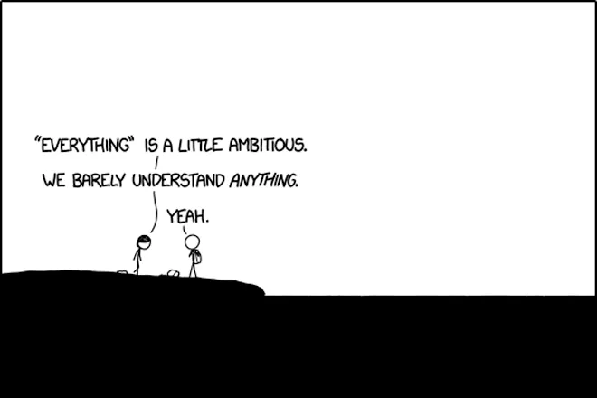

---
layout:
  width: wide
  title:
    visible: false
  description:
    visible: false
  tableOfContents:
    visible: false
  outline:
    visible: true
  pagination:
    visible: true
  metadata:
    visible: true
  tags:
    visible: true
  actions:
    visible: true
  anchors:
    visible: true
---

# Collaborations & Funding Sources

## Statement on Collaboration

While we provide our design files, assembly instructions, and software open source to the research community, we're open to working with **anyone and everyone looking to build a cleaner, more equitable, and robust energy infrastructure.** We're happy to collaborate to advance the basic energy sciences, especially by providing characterization time on our pre-built hardware setups, or by developing new hardware setups for next-stage energy challenges. If you are interested in collaborating, please reach out to us at [hardware@mit.edu](mailto:hardware@mit.edu)!

Thank you for being interested in collaborating or contributing! You're awesome! &#x20;

## Statement on Accessibility and Data

This site is hosted on GitBook and [uses cookies according to GitBook's policy](https://gitbook.com/docs/policies/privacy-and-security/statement/cookies). We've enabled the minimum data collection and maximum security settings on this website, please see GitBook's [data privacy policy for more details](https://gitbook.com/docs/policies/privacy-and-security/statement). We are constantly evaluating data privacy, **do not hesitate to contact us if you feel your privacy is being violated or data is being misused in any way.**

We have additionally disabled any AI-related tools on this site. We strongly believe that human connection and creativity is still our most powerful tool to make the world a better place, this is why we encourage you to reach out to us directly at [hardware@mit.edu](mailto:hardware@mit.edu) with questions.

Please additionally see MIT's own statement and resources for [accessibility](https://accessibility.mit.edu/) on websites.&#x20;

## Licensing & Accreditation&#x20;

[Energy Hardware Bench](https://ebh-mit.gitbook.io) © 2026 and its subprojects are licensed under a [Creative Commons Attribution-NonCommercial-ShareAlike 4.0 International License](https://creativecommons.org/licenses/by-nc-sa/4.0/) .&#x20;

You are free to **share,** copy and redistribute the material in any medium or format and **adapt,** remix transform, and build upon the material. By doing so you agree to provide **appropriate attribution,** share any adaptations **under the same license,** and **not use this work or any adaptations of it for commercial purposes without explicit licensing from MIT's** [**Technology Licensing Office**](https://tlo.mit.edu/)**.**

Please note this website also contains contributions by third parties, the specific licensing for any projects and hardware contributed by these third parties is listed on those specific project sub-pages. Please note that for these projects, EHB simply serves as a documentation hosting platform.&#x20;

#### General Accreditation

If you choose to use the tools provided on this website, please consider citing us using the EHB DOI or appropriate citations found on the subproject documentation pages or by using the general accreditation below.

<pre><code><strong>Hardware for this Project was Designed by the MIT Energy Hardware Bench (https://doi.org/10.5281/zenodo.20548028)
</strong></code></pre>

#### Project Team

Energy Hardware Bench is built and maintained by Aditya Mehrotra, Brian Roerich, and Ilian Ramirez, and is advised by Professor Alexander H. Slocum, Professor Yet-Ming Chiang, Professor Betar M. Gallant, Dr. Simon H. Bare, and Dr. Dimosthenis Sokaras. The work here would also not be possible without our collaborators and contributors, and the people listed in our [acknowledgements and funding sources](https://app.gitbook.com/s/fDzPsSIcAZQegN8oZnCv/#acknowledgements).

**Collaborators**

Alex Juroci and Professor Maureen Tang @ Drexel University

Arun Johnson and Professor Fikile R. Brushett @ MIT

Lauren Martin and Professor Franz Geiger @ Northwestern University

**Contributors**

Raul A. Marquez, University of Texas Austin

Angel Santana Torres, MIT

## #hardwareforgood Agreement&#x20;

The MIT Energy Hardware Bench maintains an open source set of scientific hardware and analytical instrumentation relevant to key areas of the energy transition. With sustainable energy being a linchpin for many, if not all of the United Nations Sustainable Development Goals, we strongly believe that highly accessible scientific and engineering tools can bring more groups into the energy conversation and aid the effort to accelerate technologies out of the lab towards real world impact. We want to lower the entry barriers for research, put the right tools in more hands, enable transparent access to rigorous scientific methodology, and empower scientists from all backgrounds. We're happy to work with anyone and everyone aligned with this mission and encourage creativity in expanding the network of communities we engage with.

By utilizing the resources on this website, in addition to the license agreements above and those listed under each project's specific sub-pages, you agree to use any hardware for the good of humanity. We actively encourage educational adaptations of our work, or citizen science projects that bring energy education into more classrooms and communities. Please reach out to us at [hardware@mit.edu](mailto:hardware@mit.edu) with any questions or ideas.

<figure><figcaption>
Panel 1,702 of "Time" by Randall Munroe
</figcaption></figure>
