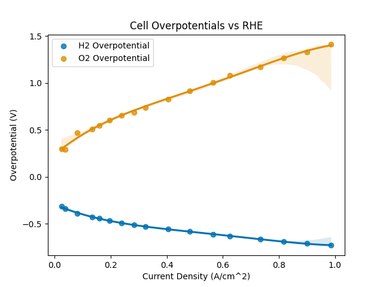
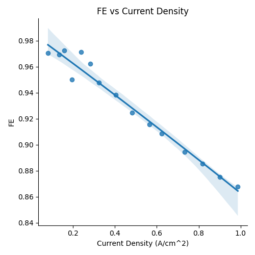

# Observable H Flow Cell


We've only documented one of our test cells at this time, more detailed documentation on the H-Cell and other test cells will be uploaded here in the future.&#x20;


### Overview

The **observable flow H-Cell** is designed to mimic a small scale alkaline electrolyzer, AEM electrolyzer, or similar wet electrochemical H-cell system. It features space for two 25mmx25mm plate electrodes separated \~10mm apart depending on the O-ring compression. It uses 1/4" push-to-connect, 316L Stainless Steel compression fittings to connect the inlet and outlet tubes. The electrodes are held in by press-fit [StonyLab 304 SS Electrode Holders](https://stonylab.com/products/b0b1djqq46-electrode-holder). **It also has a connection for a** [**Gaskatel Mini Hydro-Flex Reference Electrode**](https://gaskatel.com/shop/reference-electrodes/mini-hydrogen-reference-electrode-mini-hydroflex/)**.**

<figure><figcaption></figcaption></figure>

Note that for optimal results, it's recommended to have the outlet of the cell at the top (this is considered the vertical orientation). In this case, electrolyte is flow upwards to collect gas bubbles and transport them out of the cell in the same direction as the natural density-difference driven motion.

<figure><figcaption></figcaption></figure>

### CAD and Manufacturing

All parts of the cell can be manufactured in-house with a standard mill setup and standard tooling. **We recommend the use of sharpened stainless steel tooling when machining PEEK, while Carbide is harder, stainless steel can be sharpened to a extremely fine cutting-edge and provides a better surface finish on plastic.**&#x20;





#### Window Snap-Fit

The cell uses [50mm diameter, 1mm thick Sapphire (Al2O3) uncoated windows from Edmund Optics](https://www.edmundoptics.com/p/50mm-Dia-1mm-Thick-Uncoated-Sapphire-Window/51018/). These windows are extremely compatible with 30wt% KOH electrolyte all the way up to elevated teperatures. For other applications, these windows can be replaced with Quartz or similar materials to enable observability and wide chemical compatibility. The sapphire windows are snap-fit into the PEEK. We reccomend machining the window recess out to \~50.5-51mm in diameter. **Take off a little at a time until the sapphire window fits snugly inside, it should not be too hard to press in otherwise it can break. The recess should not be too large in diameter otherwise the window can fall out during assembly and disassembly.**&#x20;

#### Electrode Holder Press-Fit

The electrodes are held in by press-fit [StonyLab 304 SS Electrode Holders](https://stonylab.com/products/b0b1djqq46-electrode-holder). We are currently working on other more inert options for this cell. These holders are 6mm in diameter nominally. We recommend a 5.8mm drill (or -0.2mm undersize) for the holes for the electrode holder to enable them to snugly press fit into the PEEK. **It is recommended you measure the electrode holders with calipers before drilling the hole to adjust for variation.**

**Note that these electrode holders come with rounded-head phillips-style screws.** To reduce the spacing between the window and the electrode surface to allow larger working distance for a microscope (Raman or similar), these screws need to be replaced with [M3x0.5mmx4mm set screws](https://www.mcmaster.com/products/92029a101/).

#### Electrodes

Metal plate electrodes for this cell were purchased from [Redox.me—Ni plate electrodes, set of 10, 25x25mm](https://redox.me/products/metal-plate-electrode?variant=42213268652253).

### Chemical Compatibility

The following initial chemical compatibility matrix can help you modify portions of the cell to build one compatible with your electrolyte! Please contact us w/ questions or for additional reccomendations.&#x20;

<figure><figcaption></figcaption></figure>

### Assembly Stack-Up

The cell is designed to seal from room temperature up to 80°C. The stack is held together by M5 316SS bolts and O-ring [compression is set by shim washers](https://www.mcmaster.com/products/shim-washers/shims-2~~/shims-5~performance~chemical-resistant-1/system-of-measurement~metric/id~5-0-mm/id~5-mm/); here is a short [quickstart guide for an un-observable version of the cell that shows the spacer assembly](https://wandering-walk-e27.notion.site/Test-Cell-Quickstart-Guide-25ad6cc88e91807eb4afdca9031c2dfd?pvs=73). Between the end-caps and the cell body there are 0.5mm spacers to maintain O-ring compression; between the two cell halves (where the diaphragm sits) there is a total of 1.5mm (1x 1mm and 1x 0.5mm) metal spacers. &#x20;

<figure><figcaption></figcaption></figure>

<figure><figcaption></figcaption></figure>

### Initial Data


Please note that the data presented here is preliminary; all data will be re-run and republished before the first release of the H Flow Cell


#### Production Rate and Cell Efficiency vs Power

Plots production rate vs power for the default electrode spacing. Ni-plate electrodes in 30wt% KOH prepped by CV, Zirfon Perl UTP 220 Diaphragm. Production rate and power measured using QUASAR-MS.

<figure><figcaption></figcaption></figure> <figure><figcaption></figcaption></figure>

#### Cell Overpotentials and FW vs Current Density

Overpotentials and FE vs current density for the default electrode spacing. Ni-plate electrodes in 30wt% KOH prepped by CV, Zirfon Perl UTP 220 Diaphragm. Production rate and power measured using QUASAR-MS.

<figure><figcaption></figcaption></figure> <figure><figcaption></figcaption></figure>

#### EIS Data

EIS Curves for Default and Closer electrode spacing.  Ni-plate electrodes in 30wt% KOH prepped by CV; Zirfon Perl UTP 220 Diaphragm. **Note closer spacing has lower bulk resistance at higher frequencies (see x-axis crossover point).**

<figure><figcaption></figcaption></figure>
