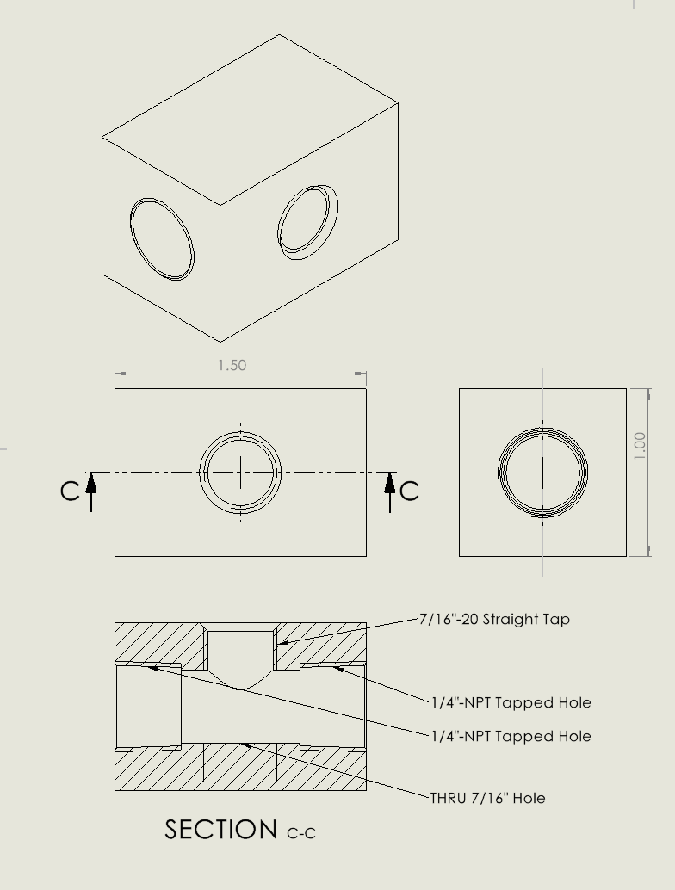
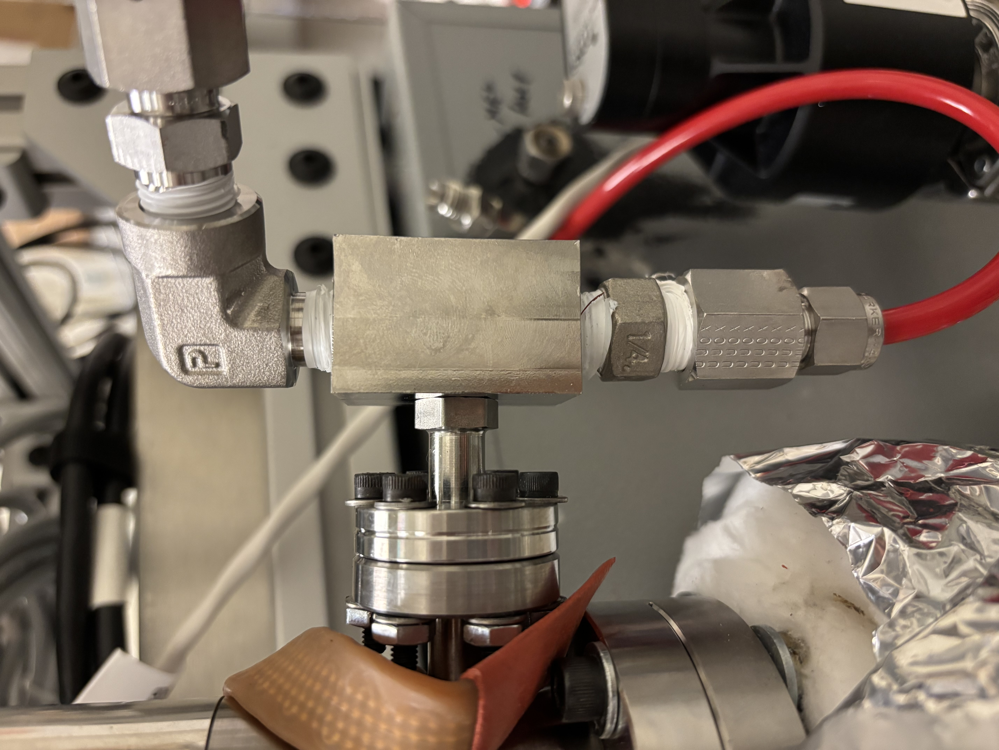
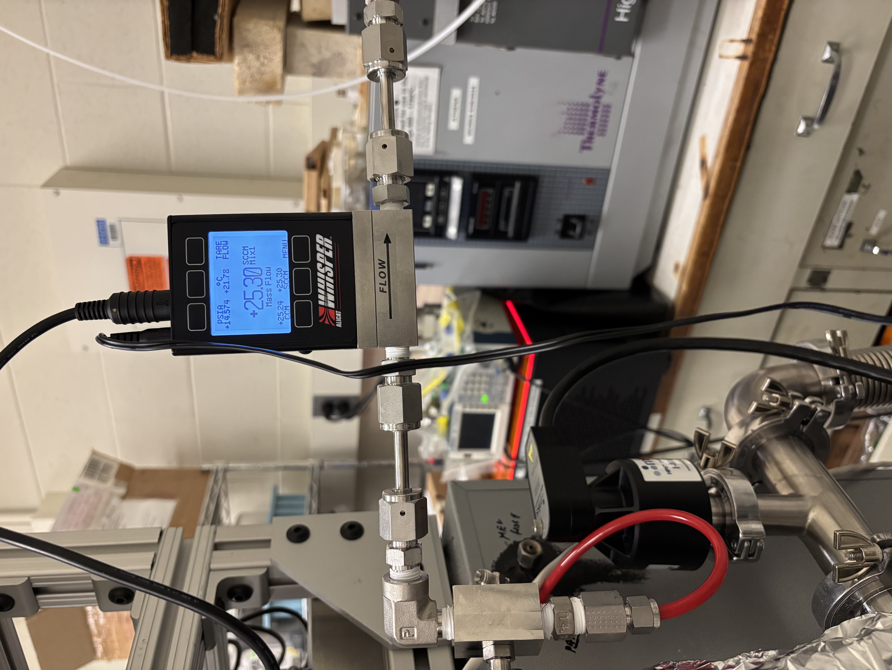
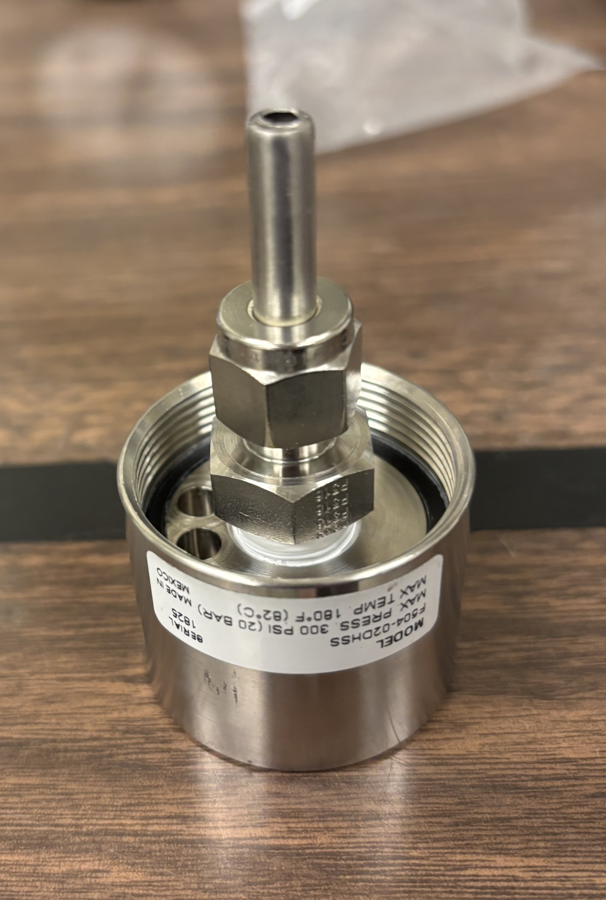
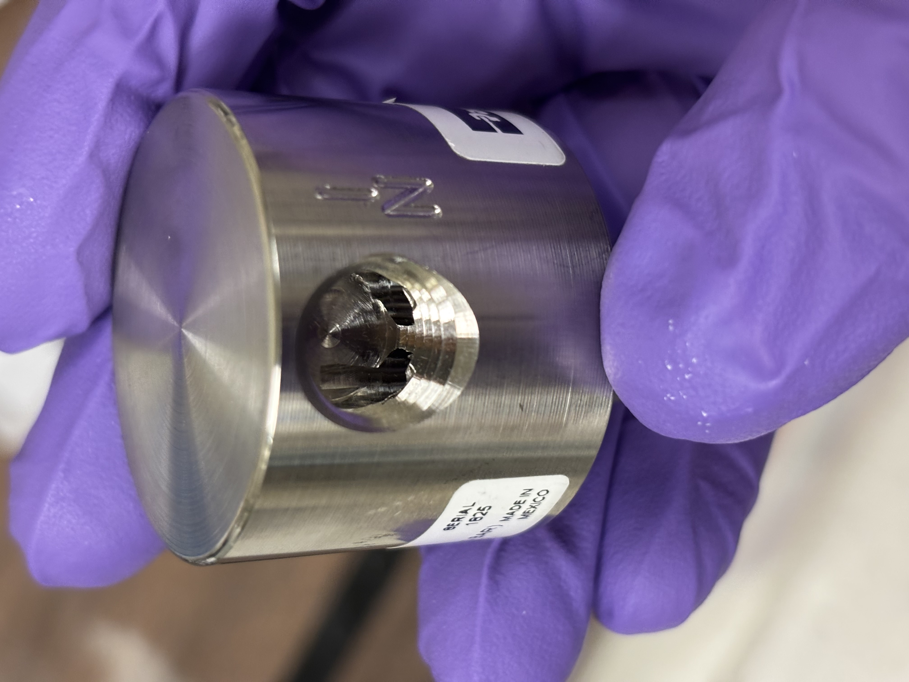
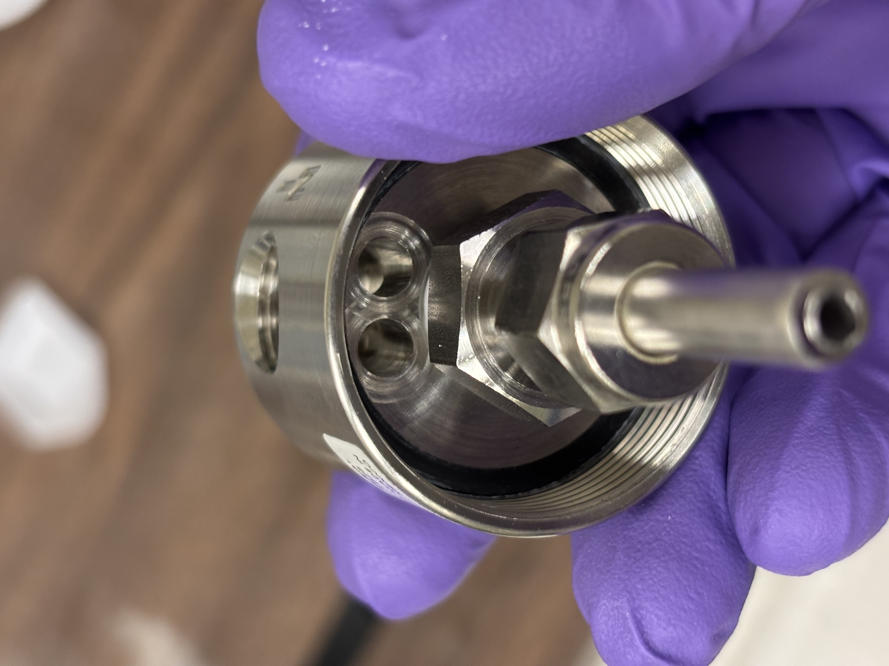
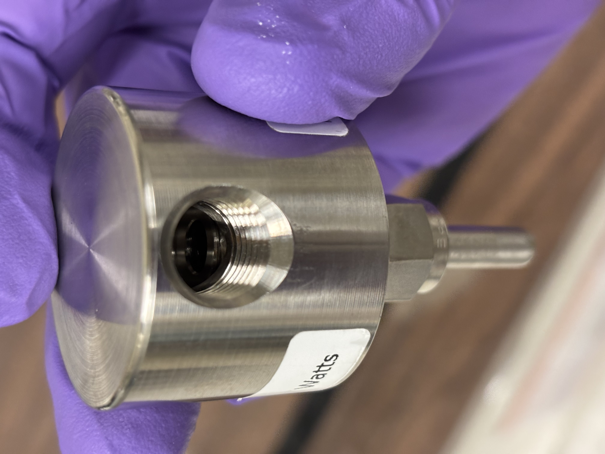

# Gas Processing & Sampling System

The gas processing and sampling system will be modified slightly for the application. This documentation is listed in order of least to most modification required for a specific application.

<figure><figcaption>
The gas from an electrochemical cell is picked up by the Argon carrier in a bubbler. This mixture passes through a multi-stage filtration system before being passed through the sampling T where some gas leaks in to the mass-spec. The rest of the gas passes through the composition-aware mass-flow-meter.
</figcaption></figure>

### Sampling T Machining

The sampling T, for the most part, is the only part on **QUSAR** that must be custom fabricated. It is a simple-enough part and should be able to be made with the capabilities of any standard university machine shop. However, we may be able to provide machining services should you need it for your project.

<figure><figcaption>
Drawing of Sample-T Part in CAD
</figcaption></figure>

The sampling T is made of 316 Stainless Steel to avoid corrosion. It is essentially a manifold with two 1/4"-NPT female threads on either side of the thru-bore, and a 7/16"-20 female thread on the branch. The branch is designed to screw directly onto the [CF-16 to Swagelok fitting](https://www.idealvac.com/en-us/product/pp/P102253) on the Agilent Leak Valve in place of the nut. **We recommend the use of PTFE sealing tape, or better Torr-seal vacuum epoxy to seal the sampling T onto the fitting.**



The sampling T is connected to the gas processing system and the output mass flow meter via the 1/4" NPT fittings. The exact fittings configuration may change slightly based on the chosen gas processing system and the mounting requirements on the mass flow meter.

<figure><figcaption>
Example final configuration of the sampling T.
</figcaption></figure>

CAD files are available for the sampling T in SOLIDWORKS format. During manufacturing, **it is recommended to start with 1"x1"x6" 316SS Bar stock.** Recommended steps are (1) cut stock to 1.5" nominal length, (2) perform 6-sided facing process to square the stock, (3) dill holes, (4) tap. Drilling and tapping should be performed on the mill to ensure taps are straight.



### Output Mass-Flow Meter Connection

The back-pressure of the mass flow meter (MFM) and gas processing system can significantly affect both the process we're trying to measure, and our ability to continuously and safely sample the analyte. For this reason, **QUASAR** uses an [Alicat 100SCCM Whisper-Series Low-Pressure Drop MFM](https://www.alicat.com/products/gas-flow/mass-flow-meter/low-pressure-drop-mass-flow-meters/). These meters have differential pressures as low as 0.07 PSID which makes them ideal for coupling with bubblers, mass spectrometers, and other devices where pressure build-up in a headspace can cause issues.

<figure><figcaption>
ALICAT Whisper Series MFM
</figcaption></figure>


As of May 2026, we are unaware of other MFM manufacturers that produce models with equivalent or lower pressure drops. Even pressure drops as low as 1.0 PSID typical of laminar flow meters can **cause significant builup in the headspace leading to leaks and erroneous readings. The MFM is one of the most important components to choose correctly for this reason.**


Another feature of the Alicat MFMs that make it particularly attractive for **QUASAR** is the COMPOSERTM feature which allows users to provide updated gas composition data in real-time to the MFM which the meter then uses to calculate the true total mass flow rate. The meter is also inherently temperature and pressure compensated. **In later sections, we provide detailed examples of how the QUASAR system uses this feature to quantify volatile product flow rate.** &#x20;

<figure><figcaption>
The selection of down-steam components determines the performance of the process and the sampling ability of the system
</figcaption></figure>

#### Connection to the Sampling T

If the **QUASAR** system is oriented horizontally (specifically if the through-path of the sampling T is oriented horizontally), then the input and output of the sampling T are interchangeable. If the through-path of the sampling T is oriented vertically, the input opens to the bottom and the output opens to the top. The reason for this is to minimize the risk of gas getting 'trapped' as the piping bends to change orientation.&#x20;

<figure><figcaption>
Example of light gas trapping in kinked tubes under gravitational force.
</figcaption></figure>

There are two possible methods to attach the MFM to the output of the sampling T. One method is to use the mounting screw holes (8-32 UNC) and a custom bracket that can attach the MFM to a table, subframe, or other rigid mounting system. The MFM can then be connected to the sampling T via a [1/4" hard tube](https://www.mcmaster.com/5635K63/). A [1/4" NPT-1/4" Swagelok tube fitting](https://www.mcmaster.com/5182K111/) connects the sampling T to the tube, and a [1/8" NPT-1/4" Swagelok tube fitting](https://www.mcmaster.com/5182K807/) connects the tube to the input of the MFM. **Note the MFM has an input and output port.** The output port can be connected to an exhaust tube via another [1/8" NPT-1/4" Swagelok tube fitting](https://www.mcmaster.com/5182K807/) which can be piped into a fume hood or other compatible exhaust system. The parts for this form of mounting are listed in the BoM.&#x20;

Please see the [manufacturer manual](https://documents.alicat.com/manuals/DOC-MANUAL-M.pdf) for mounting instructions. **The Alicat MFM can be mounted in any orientation and on a vibrating surface, however we recommend the meter be mounted as level to the earth as possible and isolated from vibrations.**



Alternatively, the MFM can be rigidly mounted to the sampling T through the use of hard fittings. **We recommend the use of Swagelok** [**VCR fittings**](https://www.mcmaster.com/products/vcr-compatible-fittings/ultra-high-polish-gasket-fittings-for-stainless-steel-tubing-9/) **that use a** [**metal gasket**](https://www.mcmaster.com/9066N451/) **(Ni being preferred for chemical compatibility) to create vacuum-quality seals between faces.** These fittings can also rotate during assembly and lock during tightening so the orientation of components can be adjusted before mounting is complete.&#x20;

<figure><figcaption>
Example of a rigid mounting of the Alicat MFM w/ VCR fittings
</figcaption></figure>

Examples of mounting the MFM to a simple version of the **QUASAR** system are shown below. Refer to the [discussion of over-constraint on the previous page](mass-spectrometer-and-vacuum-system.md#subframe-mechanical-support), the same design principals apply here when mounting the MFM to the vacuum system. The MFM should only see rigid connection in one location to avoid over-constraint which could lead to significant internal stresses.



<figure><figcaption>
Rigid mounting of MFM, flexible coupling
</figcaption></figure>




<figure><figcaption>
Rigid mounting by rigid coupling
</figcaption></figure>



<figure><figcaption>
Over-constraint by two rigid couplings
</figcaption></figure>

### Gas Processing System

The analyte gas stream is often composed of contaminants and water vapor that can degrade vacuum system and MFM components, connections and seals, and cause erroneous readings. In the case of alkaline water electrolysis, potassium-hydroxide salts (KOH) from the electrolyte can travel as vapor with the humidity (H2O/Water Vapor) and cause corrosion to the internal components of the MFM, leak valve, and the head of the mass spectrometer. The water vapor itself (even if the absence of KOH) can cause errors in flow-rate measurement, and condense inside the small opening of the Agilent leak valve causing it to clog. **Gas processing is a critical step to ensure long system life and accurate readings.**&#x20;

There are _many ways to process a gas stream for analysis, and **they will generally be customized to your specific gas stream and application.**_ Here, we present the design of a gas processing system for alkaline water electrolysis using 30wt% KOH electrolyte. You may be able to easily repurpose this design for your application.

<figure><figcaption>
Electrolyzer, bubbler, and inert gas input coupling to produce an Ar + H2 + H2O + KOH vapor stream
</figcaption></figure>

Let's imagine an alkaline electrolysis system connected to a bubbler. Electrolyte is flown from the bubbler, through the electrochemical cell where the reaction happens, the resulting gas is picked up and then returned to the reservoir and bubbled into the headspace. In the headspace is a connection for inert gas (Ar) input. Argon is flown in at a known flow-rate (\~25sccm) using a mass flow controller and it mixes with the H2 gas and vapors from the system to form an Ar + H2 + H2O + KOH vapor stream. This leads to our design question: **how might we process this gas stream to protect any downstream equipment and ensure accurate results?**

We can think of the gas processing in this case in a two steps. The first (1) is **neutralization**, we need to eliminate the corrosive KOH vapors from the gas stream, the second (2) is **drying**, we need to remove the water from the gas stream. Once these two steps are complete, we should be left with just a dry mix of Ar + H2 which can be directly analyzed.

#### Neutralization

Neutralization of the KOH vapors can include direct neutralization via and acid-base reaction, or more simpler dilution. We will use the dilution route in this example.&#x20;

<figure><figcaption>
Bubbler for KOH dilution
</figcaption></figure>

The simplest method for dilution is to use a bubbler with pure DI water inside. The gas stream enters the bubbler and the KOH dissolves back into the water. Since the KOH is extremely dilute here when compared to the 30wt% KOH bubbler prior to this, the KOH stays dissolved. What exists the bubbler is humidified gas stream of Ar + H2 + H2O ready for further processing.&#x20;



Such a bubbler can be bought off the shelf, but to make such a bubbler we can modify a [Parker F504 compressed air filter](https://www.mcmaster.com/4285K12/). The parker filter has a gas inlet (on the left side of the diagram below) and an outlet connected to a central vortex separator-filter system. The stianless-steel version of the filter was chosen for its corrosion resistance.

<figure><figcaption>
Parker-Watts corrosion resistant air filter
</figcaption></figure>

**We will modify the parker filter into a bubbler by using a** [**1/4" tube fitting**](https://www.mcmaster.com/5182K863/) **and a** [**small amount of stainless steel tube**](https://www.mcmaster.com/89785K803/)**.** Cut the stainless steel tube to about 1" of length, this should be sufficient for the bubbler modification. Unscrew the bowl of the parkery filter and _remove the plastic air-filter assembly by unscrewing it from the lid._

<figure><figcaption>
Assembled bubbler "head"
</figcaption></figure>

After removing the filter, connect the 1" stainless steel tube to the Swagelok fitting. Then apply PTFE sealing tape to the threads and screw the assembly into the filter mounting point. See this great tutorial on [how to apply PTFE tape](https://support.boshart.com/how-to-apply-ptfe-thread-seal-tape) if you're unfamiliar. **PTFE tape should be used for all NPT and threaded gas connections on QUASAR.**&#x20;



<figure><figcaption></figcaption></figure>



<figure><figcaption></figcaption></figure>

<figure><figcaption></figcaption></figure>





<figure><figcaption></figcaption></figure>



<figure><figcaption></figcaption></figure>

Credit for Diagrams: [https://support.boshart.com/how-to-apply-ptfe-thread-seal-tape](https://support.boshart.com/how-to-apply-ptfe-thread-seal-tape)



Note the direction of the tape versus the direction of pipe threading. **PTFE tape should be wrapped opposite the direction of thread movement (or tightening) so it does not loosen.** &#x20;

Note that this stem that you have just installed is the **inlet of a bubbler,** gas would flow down into the bowl from this tube. However, **according to the manufacturer this stem is installed on the outlet port.** Constructing the bubbler this way is OK, however it should be installed with the gas input from the analyte connected to the OUTLET port rather than the INLET port.


{% column width="50%" %}
<figure><figcaption></figcaption></figure>

The inlet port becomes the outlet port


{% column width="50%" %}
<figure><figcaption></figcaption></figure>





<figure><figcaption></figcaption></figure>

The outlet port becomes the inlet port



<figure><figcaption></figcaption></figure>



The bowl can then be filled with pure DI water and screwed back on, the bowl can be safely drained into a chemical waste container by attaching a 1/8 NPT chemically-resistant hose to the outlet port and following the manufacturer steps for draining the bowl.

#### Drying

To dry the gas which is now largely saturated with water vapor from its prior trip to the neutralizer, we can use a simple [low-pressure-drop desiccant dryer](https://www.mcmaster.com/5163K17/) for air and inert gasses. These bowls are filled with silica gel or a molecular sieve to trap water. When the desiccant is used up (indicated by a color change from blue to pink), the desiccant can be removed, dried in an oven, and then re-used.

<figure><figcaption></figcaption></figure>

These desiccant dryers can be used directly in the **QUASAR** system. They are installed in-line after the neutralizer and before the sampling T. **Use PTFE tape to create sealed connections between the**  [**NPT adapters**](https://www.mcmaster.com/48805K81/) **and the connection to the bubbler.**&#x20;

#### Putting the Gas Processing System Together

The final gas processing system is simply the combination of these two components, and the connection to the sampling T, and analyte stream input.&#x20;

<figure><figcaption>
The neutralizer is connected to the dryer via a ¼ NPT fitting, the inlet and outlet are connected via tubes to the rest of the system
</figcaption></figure>

While for the mass-flow-meter, rigid connection to the sampling T was an option, we do not reccomend rigid connection of the gas processing system to the sampling T the same way. Gas processing systems are heavy, and become heavier with operation as they absorb KOH and remove water. **The gas processing system should be independently mounted and connected to the sampling T via a tube.**

<figure><figcaption>
Please note that the neutralizer and dryer are <strong>not to scale</strong> in this diagram.
</figcaption></figure>

### Analyte Connection and Inert Gas Input

At this point, the **QUASAR** system is pretty much as completed as it can be. **The connection to the analyte and input inert gas flow are specific to the experiment and will need to be designed for the application.** Here, we document two example approaches to connecting the **QUASAR** system.&#x20;

#### Direct Tee Connection

The simplest connection by far (and one we use for calibrating the **QUASAR** system is just [a simple tee](https://www.mcmaster.com/5182K434/) connection). The Ar carrier gas is flown through the through-bore of the Tee, and the process gas is fed through the side port into the stream and is mixed and carried away by the Ar flow. A [check valve](https://www.mcmaster.com/45385K54/) can be used to prevent backflow into the process, **note that the checkvalve may cause backpressure and it's important to check the requirements of the valve and understand the pressure requirements of your process.**

<figure><figcaption></figcaption></figure>

#### Bubbler Connection

Another option is to use a bubbler, this was previously discussed in the gas processing example for alkaline electrolysis. In this case, a custom bubbler was machined out of PEEK. This bubbler is further documented in the electrochemical cells documentation on this website. A bubbler is ideal for connecting aqueous electrochemical systems such as flow batteries, electrolyzers, metal-air batteries, and others that can be characterized by their volatile product.&#x20;

The argon carrier gas is flown into the headspace of the bubbler, **because Ar is heavier than air, it pushes the air out creating an inert headspace**. As H2 is bubbled into the headspace it picks up water vapor and electrolyte and mixes with the Ar. This must be considered in gas processing system design.

<figure><figcaption>
Electrolyzer, bubbler, and inert gas input coupling to produce an Ar + H2 + H2O + KOH vapor stream
</figcaption></figure>

One important design note about the bubbler is that the **diameter of the inert gas input must be less than or equal to the diameter of the output orifice.** The reason for this is that if the output orafice (or fitting) is smaller than the input orifice (or fitting) the bubbler can see back-pressure and pressurize. **This is true for all custom components in the flow line; orifices should generally be sized to be equal or increasing in diameter further down the gas path to minimize pressure drops in the system.**

#### Inert Gas Input

**QUASAR** uses a known flow-rate of an input inert carrier gas (Ar). Other inert gasses may also be used depending on the application. Inert gas is supplied via a gas cylinder (size T/K/S or similar) through a [regulator](https://www.mcmaster.com/7951A62/) set to <50PSI (based on MFM manufacturer specifications).

The regulator connects to an input mass-flow meter (MFM) via the standard 1/4" Tube and Swagelok fittings. Because we used an [MKS 946 Vacuum System Controller](https://api.p1.mks.com/medias/sys_master/resources/h17/h93/10044827533342/946-DS/946-DS.pdf) on our system, we use an [MKS mass flow meter](https://www.mks.com/p/GM50A013103SMM020) and [946 MFM Control Card](https://www.idealvac.com/en-us/product/pp/P1012844) for simplicity. The MFM can be connected to the 946 via [a pre-made control cable](https://www.idealvac.com/en-us/product/pp/P1012858).

The requirements on the input mass flow meter are far less stringent than the output mass flow meter. **Any input mass flow meter can be used, we recommend a 100sccm range, and for accurate data the ability to send data from the mass flow meter to a computer via python.**

### Gas Line Management

A few brief notes on gas line management including gas path direction, tube lenght, and orafice/fitting sizes.

#### Gas Path Direction

When measuring volatiles that are less dense than air, the gas line should always progress "upwards" to ensure gas does not accumulate in any part of the system. The opposite is true for gas that is denser than air, the lines would be designed to progress downwards. This concept is illustrated below for a **lighter-than-air gas such as hydrogen H****2****.**

<figure><figcaption>
Poor management of gas lines can lead to pockets where gas can get trapped
</figcaption></figure>

<figure><figcaption>
Simplest complete configuration of <strong>QUASAR</strong> with good gas line management
</figcaption></figure>

#### Orafice Sizing

As mentioned previously, as you progress along the gas path orafice / fitting / tubing sizes should remain as constant as possible, or if anything slightly increase. **Decreasing orafice size in the direction of flow can cause backpressure build up which will cause issues in the reaction vessel and in accurate flow measurement.**&#x20;

#### Tube Length

Tubes in the system should be kept as short as possible and components should be kept as small as possible. **This minimizes the gas travel path and residence time in the system which provides faster equilibration and response.**&#x20;


Note that using a peristaltic pump or similar to pump electrolyte through a flow cell causes oscillations in gas flow that can be picked up by the mass spectrometer and flow meter due to their high sensitivity. We recommend using the [KNF FP-7 diaphragm pump](https://knf.com/en/us/solutions/pumps/series/diaphragm-liquid-pump-fp-7) or similar to minimize these flow oscillations for more accurate quantification. Special thanks to Arun Johnson for this recommendation! &#x20;

