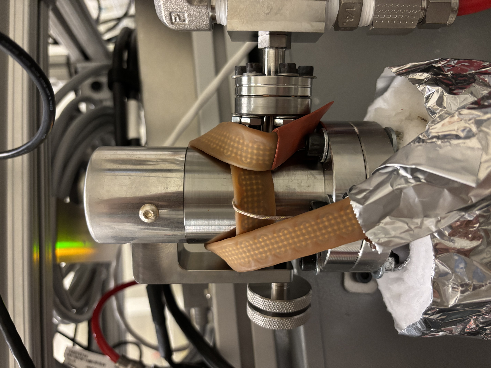
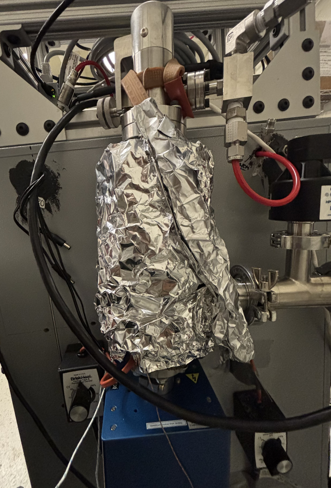

# Mass Spectrometer & Vacuum System

This section provides documentation and instructions to assemble the Mass Spectrometer & Vacuum System. It also provides recommendations for modifications to this design; or off-the-shelf alternatives available for purchase.

<figure><figcaption>
Continuous sampling system, vacuum system, and mass spectrometer.
</figcaption></figure>

Before continuing to the assembly and bill-of-materials, the core of the **QUASAR** system uses an [MKS E-Vision 2 Residual Gas Analyzer](https://www.mks.com/f/e-vision-2-residual-gas-analyzer). It's important to note that a number of companies including MKS Instruments offer complete process monitoring solutions which include an RGA, leak-valve, and turbo pump system. It is well worth checking out [MKS Instruments Complete Process Monitors](https://www.mks.com/c/process-monitors), as well as those from [Ideal Vac Products](https://www.idealvac.com/en-us/Residual-Gas-Analyzers/ct/18-2052) to see if any of these completed systems may suit your needs. Here's a few things to consider:

* Complete process monitors _may_ or _may not_ provide a more cost-effective alternative to a custom-built setup. This depends on your measurement needs. Likely, complete monitors will have a longer lead time, but also will not require as significant an assembly process.
* MKS complete process monitors are likely to be directly compatible with **QUASAR's** software libraries, they also include heater jackets for easier bake-outs which is a key part of RGA maintenance. Ideal Vacuum Products RGAs are more cost-effective alternatives to those provided by MKS instruments. They are designed for different pressure operating ranges, sensitivities, and applications. They do not come with heaters and these will need to be added for proper operation. All these should be considered in selection of a complete process monitoring station, it is recommended to consult application engineers at each company when making this decision.
* In _all_ cases, multiple mass ranges, detector, and multiplier options are available including 1-100amu, 1-200amu, 1-300amu.&#x20;

<figure><figcaption>
MKS Instruments Complete Process Monitor
</figcaption></figure>

#### Mass Spectrometer Mass Range, Detector, and Multiplier Selection

**QUASAR** uses an MKS E-Vision 2 with a mass range of 1-100amu with a multi-channel plate dual detector and tungsten filament (P/N EV2-120-000FT from MKS Instruments and Newport Corporation). You may choose to use the same part number, or any other E-Vision 2 RGA as a drop-in replacement for your system. See the following FAQ or contact [insidesales@mks.com](mailto:insidesales@mks.com) for help selecting an RGA.

<strong>Should I use a 1-100 amu or 1-200 amu mass range for my system's RGA?</strong>

The RGA mass range depends on what kinds of compounds you expect are present in your process analyte stream. For detecting H2, O2, N2, Ar, CO2, and other common gasses a 100 amu range is sufficient. For larger hydrocarbons and for detecting contaminants such as oil in a gas stream the 200 amu option is generally required.

<strong>Do I need a dual-detector w/ the electron multiplier, or is the standard Faraday detector sufficient?</strong>

For most applications where analyte components make up a significant portion of the gas stream, the standard faraday detector is sufficient and the chamber pressure must be below 1e-4 torr (1.3e-4 mbar). For detection of trace gasses where high sensitivity is required the electron multiplier may be required, however the vacuum chamber pressure must be below 1e-5 mbar to protect the RGA equipment which may require some changes to the vacuum system. **Please note that while the default RGA selected for QUASAR has the multiplier option installed, this option is not used for default measurements and all measurements are taken with the faraday detector.**

<strong>Should I use Tungsten or Thoria Coated Iridium based filaments?</strong>

**The default Quadrupole system recommends the use of Tungsten filaments.**

Thoria-coated filaments are generally preferred in RGA applications due to their lower operation temperature which results in lower outgassing, and longer filament life leading to excellent stability in UHV conditions. However, Tungsten filaments are more robust to harsh chemicals, hydrocarbons, and high pressures so they are preferred due to the nature of the compounds that we are likely to analyze in energy research applications.

### Design Files and Bill-of-Materials (BoM)



The CAD assembly for the mass spectrometer and vacuum system assembly is available in [this dropbox folder](https://www.dropbox.com/scl/fo/zn1hr1p9uctv5b1y81134/ACyBzIeHuBMqNcAEMABZ_zA?rlkey=6jjbzv1f56ajq109tgcrmfmvg\&st=uwwl6i5d\&dl=0) both in Solidworks and STEP file formats. Please note we only support Autodesk Fusion CAD for online previews.

#### Notes for Viewing the CAD

Please note that public CAD files are not available for parts such as the leak valve, cold cathode sensor, RGA, and butterfly throttle valve. For these, we've included suitable representative CAD files as visual aids in assembly. While the parts may look slightly different, the interface types and sizes, and any necessary seals and gaskets are correct.

<mark style="color:violet;">**Purple**</mark>**&#x20;**<mark style="color:$warning;">**(or yellow in Fusion 360)**</mark>—represents the [Agilent Variable Leak Valve](https://www.agilent.com/en/product/vacuum-technologies/vacuum-components/vacuum-valves/variable-leak-valve?srsltid=AfmBOoowB9VUczjTyfdldpLvAySimS9DPg4q37r8qiT20qwID8417ncV)

<mark style="color:green;">**Green—**</mark>represents the [MKS E-Vision 2 120-000FT RGA](https://www.mks.com/p/e-vision-2-residual-gas-analyzer/e-vision-2-general-purpose-residual-gas-analyzer)

<mark style="color:red;">**Red—**</mark>represents the [MKS 423 I-MAG Cold Cathode Sensor (ISO KF-25 Flange)](https://www.idealvac.com/en-us/MKS-HPS-423-I-Mag-Cold-Cathode-Vacuum-Gauge-Sensor-NW25-KF25-PN:-104230004/pp/P103331?srsltid=AfmBOoo0JsPzhLdEuQvRzT_nNKGDxGnHYgnIOEW-6QHdcxuoUgJonaTp)

<mark style="color:blue;">**Blue—**</mark>represents the MKS 153D-20-40-1 Butterfly Throttle Valve

#### System Cross-Section View

<figure><figcaption></figcaption></figure>

#### Bill-of-Materials

Note that the following BoM includes the basic version of the entire **QUASAR** system including subsystems (1-6). While we try to keep this document as up-to-date as possible, additional components may be listed on documentation sub-pages for debugging and patch fixes. **Also note that parts are listed by subsystem not by part number, multiple instances of the same part number  may exist across subsystems in the spreadsheet but not within the same subsystem.**



### Chamber and Vacuum System Assembly&#x20;

**This is not a step-by-step assembly guide,** please refer to the CAD file above for part-to-part connections. This section goes through detailed considerations for part selection, and specific considerations for the assembly of key components, and interfaces. This guide is designed to help you determine which parts you may need, and how you might go about putting them together to build your own, functioning version of the **QUASAR** system.&#x20;

<strong>Personal Protective Equipment for Assembly</strong>

We reccomend the use of clean gloves during all assembly steps; this may involve changing gloves multiple times during the assembly process to ensure and internal components of the vacuum system do not get contaminated.

#### Subframe / Mechanical Support

**QUASAR** was initially designed for electrochemical mass spectrometry; the first version was mounted on the back of an oven. Inside the oven sat an electrochemical cell that was coupled to **QUASAR** via the gas lines. This oven, and the cart it sat on, provided the mechanical subframe and the individual vacuum system components were selected around this form factor.&#x20;



<figure><figcaption></figcaption></figure>



<figure><figcaption></figcaption></figure>



A mechanical subframe will be required for any version of **QUASAR,** this subframe will determine the form-factor, and by extension which specific components may or may not be required for the vacuum system. For example, since the first version of **QUASAR** is mounted to the back of an elevated oven with the vacuum pump placed on the floor, a 90° KF-40 flange and 48" KF-40 vacuum hose were required to provide a connection to the vacuum pump and strain-relief between the vacuum system and the pump. You system may or may not need these two components—for bench-top use, the cold-cathode sensor mounting T could be directly connected to the throttle valve and vacuum pump, emulating the design of MKS complete process monitors. An example of this is shown below:

<figure><figcaption>
Example version of the <strong>QUASAR</strong> system with direct connection to the turbo-pump station (as opposed to remote connection via a vacuum hose).
</figcaption></figure>



While the joints between vacuum system components themselves are strong enough to hold the chamber and mass-spec system together. At least one positive connection point must be made to the subframe in order to rigidly attach the system to a surface.

In the case of the remote pump system, the vacuum pump is mounted to the floor via gravity, and the vacuum chamber system is mounted to the oven with bolts via brackets. The flexible nature of the hose prevents [over-constraint](https://ocw.mit.edu/courses/2-72-elements-of-mechanical-design-spring-2009/22c0cb8444c787d92b49afe5ed97ff7b_MIT2_72s09_lec06.pdf) between the oven-ground-MS system and the vacuum pump which could lead to misalignment, leaks, and additional unwanted stress on the vacuum joints. **This represents two positive connections with a flexible coupling between them.**

In the case of direct connection to the turbo pump station, the station is directly connected to the ground or the table, and the vacuum chamber system is mounted rigidly to the pump which represents a perfectly constrained system. **This represents one positive connection.**&#x20;

<figure><figcaption></figcaption></figure>

<figure><figcaption></figcaption></figure>

If you need help designing a subframe, or would like subframe recommendations for your given application, please reach out to us.

### Tightening Instructions for KF-40 and CF-40 Flanges

For assembly of vacuum flanges, Ideal Vacuum Products has a great guide on standard vacuum flanges and how to use them. You can [download the guide from their website](https://www.idealvac.com/files/manuals/Common_Vacuum_Fittings-Selection_and_Assembly_Guide.pdf?srsltid=AfmBOorOS71LBEgsdgC3XxAJJAoy63M5dyn5OKANOWKJvKipLLGSROlQ), and an archival copy is avaliable to download below. It's worth giving the section on CF and KF flanges a read before attempting assembly.



#### Main Chamber and Mass Spectrometer

The mass spectrometer and main housing fittings use ISO CF-40 fittings which maintain sealing by compressing a copper gasket between two bolted flanges. The flanges are held together with (6x) 1/4"-28 bolts which are each torqued to \~12.43 Nm. The flanges should be carefully assembled to avoid scratching the gasket and the bolts hand-tightened, then the bolts should be tightened in a start patter by 1/12th-1/4th of a turn each with a torque wrench until the required torque is reached.&#x20;

<figure><figcaption>
Credit: Ideal Vac Products
</figcaption></figure>

#### Sensor and Vacuum Pump System

The additional flanges that attach pressure sensors, vacuum hoses, the throttle valve, and vacuum pump to the system use ISO KF-40 fittings. These fittings use Viton O-Rings compressed between two flat faces by clamping. A metal centering ring that holds the O-Ring sets appropriate compression—further compression is detrimental to sealing. **The wing-nut on the clamp should be tightened** **by hand until resistance is felt,** the vacuum system can be turned on to check for sealing. We recommend waiting about 30min-1hr of pumping time and checking the tightness of the wing nuts, **the nut can then be tightened further if resistance decreases significantly under vacuum.**

<figure><figcaption>
Credit: Ideal Vac Products
</figcaption></figure>

#### Cleaning of Flanges Prior to Assembly&#x20;

New flanges, O-Rings, and gaskets ship with protective coverings to ensure clean surfaces for sealing. If your components are new, they will not require cleaning out-of-the-box. We recommend removing **protective coverings one at a time and immediately assembling them to minimize any contamination.**&#x20;

For used flanges, sealing faces should be wiped down with Isopropyl-Alcohol (IPA) and allowed to dry. New O-Rings or copper gaskets should be used during sealing, **do not re-use compressible sealing components.**

### Mass Spectrometer Installation

It is important to follow the [official MKS installation manual](https://www.ccrprocessproducts.com/wp-content/uploads/2011/07/e-Vision2-Hardware-Manual-SP101016.102.pdf) for the E-Vision 2 RGA to ensure the safety of the instrument. **We recommend assembling the full vacuum system including the connection to the turbo-pump before installing the mass spectrometer to minimize spectrometer contamination and risk for instrument damage.**&#x20;



When installing the analyzer **consider its orientation and the mounting of the control unit.** Ensure there is enough space to mount and de-mount the control unit, and that the orientation of the control unit will not interfere with surrounding components. **The control unit can only be installed in one orientation with respect to the analyzer but the analyze can be installed in multipe possible orientations with respect to the chamber flange.**&#x20;

### Pressure Control

The Agilent Leak Valve is set to a constant volumetric input leak rate. Due to variations in gas composition, temperature fluctuations, and changes in output pumping rates with gas molecular weight, the pressure in the chamber naturally fluctuates. **Pressure control is needed to maintain a constant chamber pressure for analysis.**

<figure><figcaption>
Simple pressure control system using an MKS 946 vacuum system controller. The 946 reads chamber pressure with a cold-cathode sensor, and uses a PID control loop to set the position of a downstream throttle valve. This throttle valve changes the effective pumping rate of the turbo controlling the pressure in the chamber.
</figcaption></figure>

Pressure control, leak valve setup, and tuning is documented in a [later section](system-startup-and-tuning.md). When closed, the **throttle valve isolates the pump from the chamber causing pressure to rise, when open the full ability of the pump can be used.** PID control can be used to set the position of the throttle valve using measurements from a pressure sensor.&#x20;


**Note:** as of May 2026, we are experiencing some issues using the 946 Controller to control the position of an MKS 153D Throttle Valve with the i-Mag 423 Cold Cathode sensor as an input. We are actively working with the engineering team at MKS to solve this problem. We will provide updates as the situation progresses.&#x20;


#### Alternative Pressure Control Arrangements

The standard configuration assumes a vacuum pumping system similar to the [Drytel 1025](https://www.idealvac.com/files/ManualsII/Alcatel_drytel_1025_Manual.pdf?srsltid=AfmBOopoiOgJbkYRNLKLYYGh4QphqZQdlr2eZPVlbfGtxrwt78AEkIuo) pumping unit which provides constant pumping after the turbo has spun up. **An alternative to using a throttle valve controlled by a pressure controller is to use an integrated** **turbo-molecular pumping station.** Turbo stations are all-in-one systems that combine the turbo-molecular pump, roughing pump, and PID speed/pressure controller in a single unit. A pressure sensor can be connected to the station to complete the pressure control loop. An example of this would be the [Edwards T-Stations](https://www.idealvac.com/en-us/Edwards-T-Stations-nEXT85D/pl/5-44-231-1973) available on Ideal Vac Products.

<strong>When would I choose a turbo-station over an MKS 946 for pressure control?</strong>

**For most applications, it's likely cheaper and easier to buy a turbo-molecular pumping station from Edwards, Pfeiffer or similar brands.**

Generally speaking, this is a matter of your budget and time constraints. You can expect to pay between 8k-15k for a turbo pumping station and around 6k-8k for the MKS 946 system for pressure control (not including the vacuum pump). If your lab has high vacuum pumps lying around, it may make sense to go with the 946 system which allows for additional flexibility in terms of control and integration of additional pressure sensors and mass flow controllers. This is a lower cost option but requires higher engineering effort. On the other hand, a turbo-station can be a quick, plug-and-play, all-in-one solution to pressure control especially when paired with manufacturer reccomended gauges.&#x20;

<strong>Should I use a wet or dry backing pump?</strong>

**Generally speaking most labs use wet pumps due to their lower up-front cost despite higher maintenance requirements. However, dry pumps have advantages.**

Vacuum pumps come in two main types: wet and dry. Wet pumps are oil-based and require oil changes and regular maintenance. While they are cheaper they do risk contaminating your vacuum system with the pump oil, though this risk is low for systems like **QUASAR** if maintained properly. Wet pumps are also more resistant to contamiation. Dry pumps are much more expensive initially and require professional service if something goes wrong, but are generally maintenance free, and have low risk of contaminating your system. **Generally speaking, we reccomend the pump that your lab has the most experience servicing.**&#x20;

### Heaters and Valve Temperature Control

**QUASAR** has two heater systems, one on the main Agilent Leak Valve and a second that encases the RGA main chamber. They have distinct functions.

#### Valve Temperature Control

The Agilent Leak Valve is _highly sensitive to temperature fluctuations in the room_, even changes of 1-2°C can change the leak rate. While the pressure control system may be able to handle this, Agilent recommends slightly heating the valve to a constant temperature above room temperature for thermal stability. **Please be sure to install the valve in the test setup** [**according to the manufacturer specifications and manual**](https://www.agilent.com/cs/library/usermanuals/public/Variable%20leak%20valve.pdf?srsltid=AfmBOoqpWICOEdSv2j42jYHAfgLmt3st1QZcIIuaOq-4py9M9C_YA3WJ)**.**



<figure><figcaption>
A heater wrapped around the leak valve integrated with a thermocouple and PID controller maintains a constant temperature.
</figcaption></figure>

While any thermocouple compatible with the PID controller can be used, we chose a J-Type thermocouple for its increased sensitivity in the working temperature range.&#x20;

<figure><figcaption>
Example installation of heater tape on the valve
</figcaption></figure>

We recommend **first installing the thermocouple with Polyamide/Kapton tape or similar,** then wrapping the heater tape around the valve 1-2 times in such a fashion that it further holds the thermocouple against the valve's metal surface. **It is recommended to wrap a thin layer of fiberglass insulation, and a layer of aluminum foil around any part of the heater tape that is not contacting the valve.** This prevents the heater tape from causing unwanted heating of other components of the setup and reduces the risk of burns while working near the setup during maintenance. The aluminum foil encases the fiberglass insulation to prevent splinters or other abrasions. **We provide detailed instructions on tuning the valve, pressure controller, and temperature controller in later sections.**

#### RGA Chamber Baking System

Contamination of water, and other debris lead to significant outgassing in high-vacuum systems. To achieve low base-pressures, 'bake-outs' are generally performed where the system is taken up to \~200°C-250°C under vacuum and held there for \~24hours. During this period sensitive equipment is turned off and contaminants desorb and are pumped away by the vacuum system. The system is then allowed to cool. **A detailed bakeout procedure is documented in later sections.**

**QUASAR's** second heater system enables bakeouts at >200°C of the RGA system for periodic cleaning, and contaminant removal after a pump-down. **Please read the MKS E-Vision 2 Manual for bakeout procedures before attempting to bake any part of the RGA system.**

<figure><figcaption>
The chamber baking system uses wrap-around heater tape, and thermal insulation (such as fiberglass) to maintain high bakeout temperatures. A thermocouple is used to measure the temperature and the tape power is controller with a knob to manually control temperature.
</figcaption></figure>

Similar to the valve heater, we recommend taping the thermocouple for monitoring onto the surface of the chamber somwhere near the tip of the RGA. The heater tape can then be wrapped around and **secured with stainless steel zip-ties**. We recommend **two layers of 1" thick fiberglass insulation be wrapped around the chamber on top of the heaters, each layer individually secured with stainless steel zip-ties.** Aluminum foil should be wrapped around the final assembly for added safety. This insulation is critical to maintaining temperatures above 200°C at the RGA core.&#x20;

<figure><figcaption>
Example of the RGA heating system
</figcaption></figure>


**Note:** KF-40 flanges with Viton seals should never be baked out past 100°C as the rubber can degrade, melt, and break the seal. Only CF-40 flange types are rated for high-temperature bakeouts and the use should consider this when installing the heating system. _Ensure that no part of the heater or insulation directly contacts a KF-40 flange._


#### Other Heating Solutions

Off-the-shelf heating solutions (heating jackets and similar) may exist that fit your application. We recommend looking around at these options. Likely, these options will be expensive; the selection of an off-the-shelf solution versus a custom setup will depend largely on budget and time. However, off-the shelf system may provide more elegant means to heat the process chamber and valve.&#x20;
