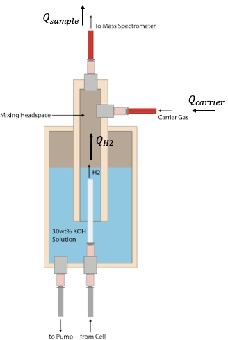

# Overview

### System Overview

The **QUASAR** system consists of seven key components: (1) the gas interface and (2) processing system, (3) the mass spectrometer interface, (4) the high vacuum chamber and pressure control system, (5) the mass spectrometer itself, (6) a composition-aware output flow meter, and (7) computer control system.&#x20;

<figure><figcaption></figcaption></figure>

<figure><figcaption>
System diagram of <strong>Quadrupole</strong> open source quantitative mass spectrometry system.
</figcaption></figure>

#### Input Gas Interface (1)

The gas interface generally consists of three main components. (1) The inert carrier gas input, (2) the mixing headspace which is unique to each type of experiment, and (3) the mixed output stream. An example implementation of the gas interface would be a bubbler connected to an electrochemical flow cell. The inert carrier gas is used to purge the bubbler headspace to produce a controller environment. The process gas is mixed with the carrier gas in this headspace to produce the analyte stream that is fed to the spectrometer system. This is a key component that is modified slightly for calibration or compatibility with a wide range of chemical reactors and electrochemical cells. We document various options and considerations in the following sections.

<figure><figcaption>
Example implementation of the gas interface, a bubbler mixes the carrier gas with the process gas to produce a analyte stream.
</figcaption></figure>

#### Gas Processing System (2)

Gas processing is generally required to ensure the analyte stream is dry and non-corrosive to the downstream analytical equipment. This set of components is also modified based on the application. The default processing system is a simple desiccant to remove water vapor from the analyte stream, however in the case of alkaline electrolysis a bubbler may be added to neutralize KOH vapors. A vacuum-rated liquid separator is also recommended in the gas processing stream. We document various options and considerations in the following sections.



<figure><figcaption>
Dessicator System Diagram
</figcaption></figure>



<figure><figcaption>
Example Bubbler System
</figcaption></figure>



<figure><figcaption>
Vacuum Fiter, McMaster-Carr
</figcaption></figure>




#### Gas Interface, Vaccuum Chamber, Pressure Control System, and Mass Spectrometer (3-5)

The core of the analysis system includes components 3-5. Mass spectrometry measures the mass-to-charge ratio (m/z) of ionized particles, the sample is ionized and then accelerated by an electric field to a known kinetic energy. The [quadrupole](https://www.youtube.com/watch?v=6_mavZ_WKoU) is a filter that only allows a single (m/z) ratio to pass to the detector at a time. The ions impact the detector resulting in a current proportional to their abundance. The mass spectrometer measures each (m/z) ratio individually and scans over a range of (m/z) ratios to identify the abundance of each species.&#x20;

This technique is performed in a high-vacuum environment (<1e-4 Torr) to ensure that as ions travel from the source to the detector they do not collide with background gas molecules (the mean free path of these ions increases). This prevents scattering, fragmentation, unwanted reactions, and signal loss which could affect readings. The mass spectrometer interface (or gas sampling system), and vacuum chamber and pressure control system are essential components that house the mass spectrometer.&#x20;

<figure><figcaption>
Continuous sampling system, vacuum system, and mass spectrometer.
</figcaption></figure>

The mass spectrometer sits inside a small vacuum chamber that has a high-vacuum manually-adjusted leak valve on one side and a downstream butterfly throttle valve on the other, these are documented further in later sections. The leak valve is set to a desired, low leak rate which allows a small amount of gas from the analyte stream to enter the vacuum chamber for analysis. The leak valve is connected to the gas stream via a "T" connector which enables continuous sampling. The amount of gas that enters the vacuum chamber via this method is negligible compared to the total flow of gas for quantification purposes in any resonable lab-scale process.&#x20;

<figure><figcaption>
A small portion of the analyte is continuously sampled through the leak valve connected to the gas stream via the sample "T."
</figcaption></figure>

The pressure in the vacuum chamber is controlled using the downstream butterfly throttle valve. A cold-cathode sensor reads the pressure in the vacuum chamber to an MKS 946 Vacuum System Controller (or similar). The 946 controller has an on-board PID loop that opens and closes the butterfly valve to decrease and increase chamber pressure respectively by moderating flow to the vacuum pump.&#x20;

#### Output Mass Flow Meter (6)

The analyte lastly flows through a composition aware mass-flow-meter. The computer control system (7) reads the composition of the gas from the mass spectrometer and continuously sends the mole fractions of up to five component gasses to the output mass flow meter. The use of a low pressure-drop flow meter is essential here to eliminate upstream pressure build up that could affect the process. This meter is used to quantify the rate of mass flow or can be configured as a totalizer for cumulative readings. The meter is internally temperature and pressure compensated, and can be externally humidity compensated.&#x20;

### Theory of Operation

Putting this together, gas output from the reaction process first mixes with the inert carrier gas in a headspace. This analyte mixture flows through any necessary gas processing before it reaches the analysis system. A _negligible_ amount of gas is continuously sampled into a pressure-controlled high-vacuum chamber where it is analyzed by the mass spectrometer to determine its composition. The rest of the gas flows to the output mass flow meter. A computer system continuoulsy reads the composition of the gas from the mass spectrometer, and can send the mole fractions of up to five component gasses to the output mass flow meter. The mass flow meter uses the gas composition information, temperature, and pressure sensors to accurately quantify the rate of mass flow of the analyte. This, combined with calibartion curves, and raw mass spectrometer data, can be use to determine the exact mass flow rates of the analyte's constituent components.

### Documentation Contents

This documentation contains design details, CAD files, a bill-of-materials (BoM), assembly instructions, and calibration and setup instructions for the basic version of the **QUASAR** system. It also contains essential data including calibration curves and procedures, stability curves, reset and rise-time data, error quantification sheets, example experimental data and procedures, pump-down and bakeout procedures for the vacuum system, recommended settings, and other tips and tricks. the documentation on this website is _as comprehensive as is practical, and we encourage you to reach out to our team at_ [_hardware@mit.edu_](mailto:hardware@mit.edu) _with questions, or engage with us on the discord server for answers to specific questions._

### How to Use this Site

We recommend you start by reviewing the documentation and assembly instructions for **QUASAR** including the bill-of-materials (BoM) to see if this project is within your time and financial constraints. We would also recommend that you reach out to the manufacturers and vendors of key parts to inquire about project timelines. We are also slowly updating a list of publications that used the hardware documented here for their experiments, we recommend reviewing these to gain a better understanding of the kinds of experiments this hardware can support. Lastly, we recommend engaging with our discord community if you have questions, or need ideas on how to adapt the hardware here to your experimental needs. It's important to note that for certain applications adaptation is straightforward while for others it may require more engineering effort. We are happy to support your engineering efforts if they significantly increase the capabilities of the **QUASAR** system, see the [collaboration page](https://app.gitbook.com/o/dW4Eui3DBvRNJuOjfNel/s/ht06X8PATyzC8f5pnAp6/) for more details.

If you are unsure if **QUASAR** will work for your application, we encourage you to reach out to us. We would be happy to provide you with initial recommendations, or run initial tests on our functioning, calibrated versions of the test setup in our own lab. &#x20;
