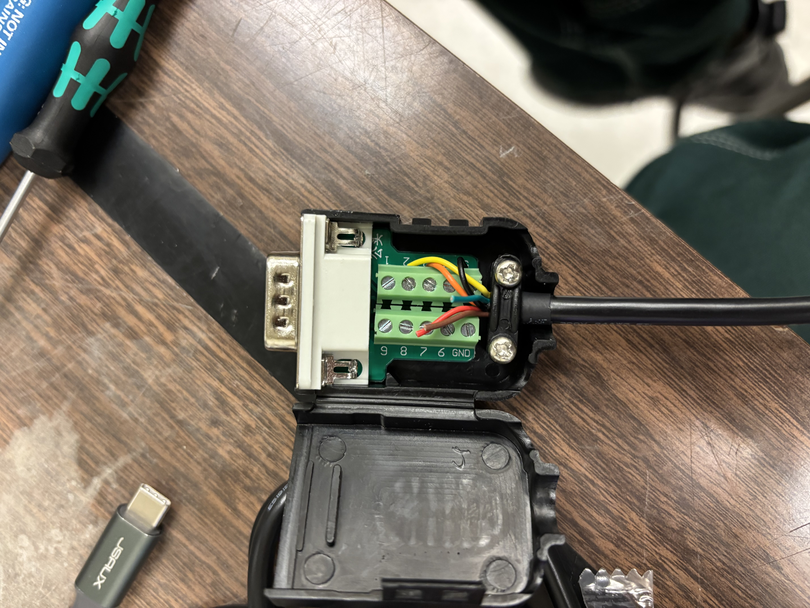

# System Startup, and Tuning

* ENSURE THE REGULATOR IS FULLY OPEN BEFORE PRESSURIZING THE CYLINDER&#x20;
* then slowly icnrease pressure until it reads...&#x20;
* Then how to adjust the Leak valve and tune the pressure controller&#x20;

**PID Tuning Process**

**Valve Tuning Process**

* RGA-in-the-loop valve tuning (SHOW A PICTURE OF THIS!!!)

**TEMPERATURE COMPENSATION of the GM50 !!! via the MKS GUI**

**Bake-out Procedure**

* pressure monitoring

**Leak Testing**

* ROR test&#x20;

**AUTOTUNING THE TEMPERATURE CONTROLLER**

[https://www.tempco.com/Tempco/Resources/User-Manuals/PCM-Manuals/InstructionsforModelPCM10001-4.pdf](https://www.tempco.com/Tempco/Resources/User-Manuals/PCM-Manuals/InstructionsforModelPCM10001-4.pdf)&#x20;


Temp Solution:

* [https://www.mouser.com/ProductDetail/895-USBRS2321.8BT5.0](https://www.mouser.com/ProductDetail/895-USBRS2321.8BT5.0)&#x20;
* [https://www.mouser.com/ProductDetail/485-3123](https://www.mouser.com/ProductDetail/485-3123)


```
@253PR5?;FF
```

RX TO TX AND TX TO RX&#x20;

* so make a color pin table for this!&#x20;
* CUT ENDS OF EXTRA CABLES TO AVOID SHORTING&#x20;
* INCLUDE STRAIN RELIEF&#x20;

It's not null modem it's straight through serial???&#x20;

| FTDI Cable        | Connector       |
| ----------------- | --------------- |
| Orange (FTDI TXD) | Pin 3 (946 RXD) |
| Yellow (FTDI RXD) | Pin 2 (946 TXD) |
| Black (GND)       | Pin 5 (GND)     |

<figure><figcaption></figcaption></figure>

<figure><figcaption></figcaption></figure>

<figure><figcaption></figcaption></figure>



INCLUDE FDTI DRIVER

[https://www.mouser.com/datasheet/3/35/1/DS\_USB\_RS232\_CABLES.pdf](https://www.mouser.com/datasheet/3/35/1/DS_USB_RS232_CABLES.pdf)

yes


We used TERMITE FOR TESTING [https://www.compuphase.com/software\_termite.htm](https://www.compuphase.com/software_termite.htm)&#x20;
