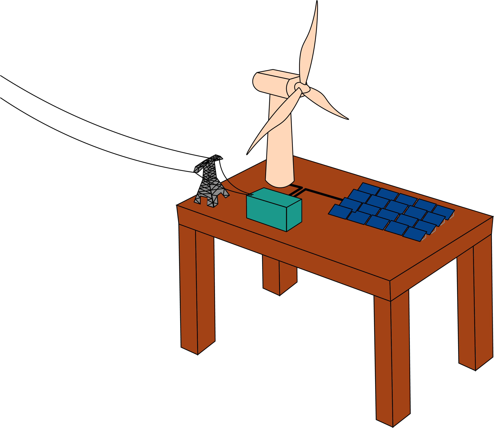
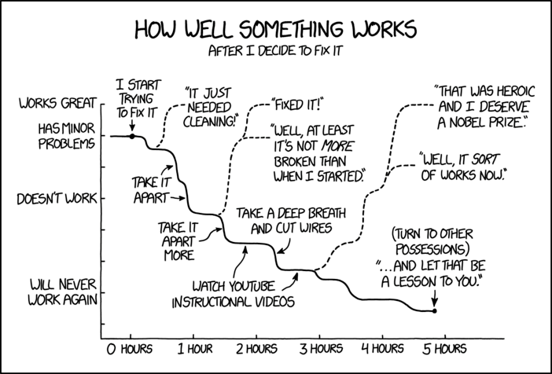

# EHB @ MIT

## Welcome to the MIT Energy Hardware Bench!

EHB is a set of open source lab-scale scientific hardware and analytical instrumentation relevant to key research areas for the energy transition including electrochemistry, materials characterization, and power electronics. This website provides detailed documentation including parts lists, assembly and calibration instructions, chemical compatibility data, safety considerations, modification suggestions, and case studies [completely free for scientific and educational use](https://app.gitbook.com/s/ht06X8PATyzC8f5pnAp6/#licensing-and-accreditation). While we've tried to document all the quirks of hardware to the best of our abilities, you're always welcome to reach out to us at at [hardware@mit.edu](mailto:hardware@mit.edu) for help and suggestions!

The tools provided here serve multiple purposes. First, they were specifically developed to reduce the engineering effort needed to collect robust data, especially in the case of operando characterization. Second, they are operable under industrial conditions, to help accelerate technologies out of the lab into the real world. Third, they are designed to be economically and technically accessible, and are made to be iterated upon by you! &#x20;

<figure><figcaption></figcaption></figure>

#### Getting Started

First of all, thank you for your interest in our project! We suggest you start by taking a look at the welcome section of the [documentation page](https://app.gitbook.com/s/3ZIyOvFjL5rwG2m14m9h/) which also includes a list of publications and projects that have used EHB's hardware. We also encourage you to peruse the software provided on our Github (see below).&#x20;

<table data-card-size="large" data-view="cards"><thead><tr><th></th><th></th><th></th><th></th><th data-hidden data-card-cover data-type="files"></th></tr></thead><tbody><tr><td><h4><i class="fa-github">:github:</i></h4></td><td><strong>GitHub</strong></td><td>Our software and hardware is 100% open source. Learn how to contribute to EHB.</td><td><a href="https://github.com/EnergyHardwareBench" class="button secondary">Software &#x26; Hardware Files</a></td><td></td></tr><tr><td><h4>⚙️</h4></td><td><strong>Discussions Community</strong></td><td>Check out our discussions community for hardware help, finding collaborators, and accessing support.</td><td><a href="https://github.com/orgs/EnergyHardwareBench/discussions" class="button secondary">Forums</a></td><td></td></tr></tbody></table>

#### Building Hardware is Hard!

We want to acknowledge outright that building anything is a difficult endeavor whether you've done it before or not. Hardware is finicky but essential to rigorous science, and debugging is an art. We cannot possibly describe the excess of problems we ran into during the development of these systems in this documentation, nor can we expect these systems to be perfect. So we humbly request your feedback and sincerely encourage you to reach out to us if you're having an issue. **No question is trivial.**&#x20;

We also understand that despite our efforts to make these tools accessible, space, funding, and time are constant constraints in research. If you're interested in running preliminary experiments on pre-built setups, or setting up a [more formal research collaboration](https://app.gitbook.com/s/ht06X8PATyzC8f5pnAp6/), please reach out to us at [hardware@mit.edu](mailto:hardware@mit.edu)!&#x20;

<figure><figcaption>
1994: Repairs by Randall Munroe
</figcaption></figure>

